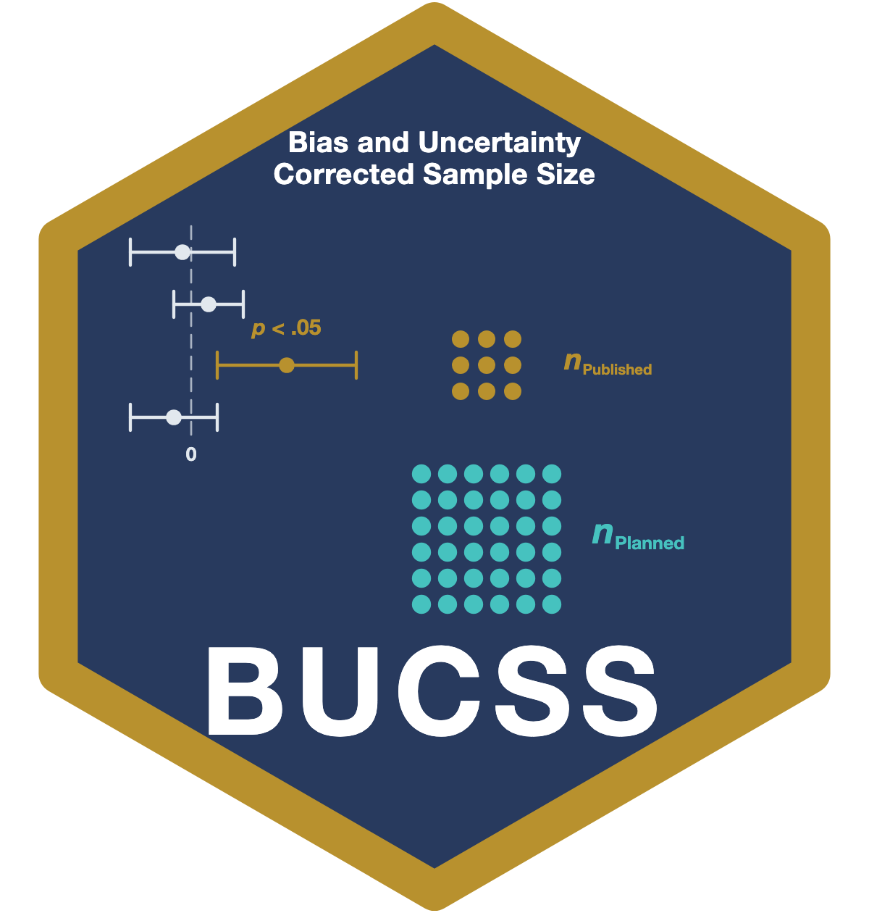

# BUCSS 

<!-- badges: start -->
[](https://github.com/yelleKneK/BUCSS/actions/workflows/R-CMD-check.yaml)
[](https://CRAN.R-project.org/package=BUCSS)
[](https://CRAN.R-project.org/package=BUCSS)
[](https://lifecycle.r-lib.org/articles/stages.html#stable)
<!-- badges: end -->

BUCSS is an R package for implementing Bias and Uncertainty Corrected Sample
Size planning. BUCSS implements a method of correcting for publication bias and
uncertainty when planning the sample size of a future study from an original
study. See [Anderson, Kelley, &amp; Maxwell (2017; *Psychological Science*, *28*, 1547--1562)](https://kenkelley.org/wp-content/uploads/articles/Anderson_Kelley_Maxwell_Psychological_Science_2017.pdf).

## Installing `BUCSS`

Install the released version from CRAN:

``` r
install.packages("BUCSS")
```

Then load the package:

``` r
library(BUCSS)
```

The `ss_buc_*` function family described below is the current BUCSS interface,
introduced in 2.0.0. The development version lives on GitHub:

``` r
# install.packages("remotes")
remotes::install_github("yelleKneK/BUCSS")
```

## Using `BUCSS`

Consider an original study in which two independent groups are used to test the
null hypothesis of no difference in the population means of the two groups
(e.g., a treatment and a control group). Suppose the independent samples *t*
test in the original study reported *t* = 3.00, with 50 and 55 participants in
the two groups and a Type I error rate of .05. The planned study seeks a
statistical power of .80 with 90% assurance that the power will be at least
.80.

``` r
result <- ss_buc_independent_t(t_observed = 3, n = c(50, 55), alpha_prior = .05,
                               alpha_planned = .05, desired_power = .80,
                               assurance = .90)
result
#>  term                  value
#>  necessary_n_per_group 1485
#>  total_N               2970
#>  actual_power          0.803
#>  ncp_adjusted          0.526
#>  smd_planning          0.103
#>  t_observed            3
#>  n_1                   50
#>  n_2                   55
#>  alpha_prior           0.05
#>  alpha_planned         0.05
#>  assurance             0.9
#>  desired_power         0.8
#>
#> Design: Independent t test
#> Sample size unit: per group
#> Largest supportable assurance: .93
```

This yields a necessary sample size of 1,485 per group (a total of 2,970).
BUCSS 1.x reported 1,482 for this example under its grid search; as of BUCSS
2.0.0 the bias and uncertainty adjusted noncentrality parameter is found by
direct root finding, which gives 1,485 (see `NEWS.md`). The row
`smd_planning` is the planning effect size, the effect size the plan is built
on: the adjusted noncentrality parameter restated as a standardized mean
difference, 0.103, where the prior study's *t* taken at face value
corresponds to 0.586. A study of 1,485 per group has exactly the
`actual_power` shown when the population standardized mean difference equals
the planning effect size.

Assurance is the long run proportion of studies planned this way, each from
its own published prior study, whose power at the true effect reaches the
desired power. BUCSS delivers it by planning from the lower limit of a
one-sided confidence interval for the prior study's noncentrality parameter,
at a confidence level equal to the assurance, computed from the distribution
of the prior statistic truncated at the publication threshold. An assurance of
.5 plans from the median unbiased estimate and corrects for publication bias
only; above .5 it also corrects for uncertainty. The term follows Kelley and
Maxwell (2003), who used assurance in sample size planning for the
probability that a confidence interval will be no wider than desired.

For this prior study, the plan grows with the assurance requested: 60 per group
at an assurance of .50, 233 at .80, and 1,485 at .90. Taking *t* = 3.00 at face
value would plan 47 per group. The prior result supports an assurance of at
most about .93 (the "Largest supportable assurance" the printed result
reports), and the plan grows without bound as that ceiling approaches, which
`plot()` draws. `vignette("understanding-assurance", package = "BUCSS")`
explains both settings.

The functions return a tidy object of class `bucss_plan`, shaped like the
result tables in the [`DMAR`](https://CRAN.R-project.org/package=DMAR) package: an
ordinary `data.frame` of `term`/`value` rows holding the design results (the
size row is named for its unit, here `necessary_n_per_group`, and the planning
effect size row for its metric, here `smd_planning`) followed by rows echoing
the planning inputs, so the assumptions travel with the result:

``` r
result$value[result$term == "necessary_n_per_group"]  # 1485
result$value[result$term == "actual_power"]           # power at that size
result$value[result$term == "ncp_adjusted"]           # adjusted noncentrality
result$value[result$term == "smd_planning"]           # planning effect size, 0.103
```

The broom verbs give the two convenient views. `tidy()` is the compact
estimate view (`term`, `estimate`, `power`), as in `DMAR`'s sample size
planners, and `glance()` the one-row wide view, which begins with those same
three columns, as `DMAR`'s does, and then, unlike `DMAR`'s, keeps every row
of the result as a column (so the sample size and `actual_power` appear
twice):

``` r
tidy(result)               # term = "sample_size", estimate = 1485, power
tidy(result)$estimate      # 1485
glance(result)             # term, estimate, power, then every row as a column
planning_sentence(result)  # the sentences for a manuscript
```

## What's New Since 1.2.1

BUCSS 2.0.0 is the first release since 1.2.1. `NEWS.md` has the full list; the
main changes follow.

### A New Interface

The functions are renamed to the `ss_buc_*` prefix (for example
`ss_buc_independent_t()` in place of `ss.power.it()`), so the names make clear
that these planners apply the bias and uncertainty correction rather than
ordinary power analysis. Arguments are snake_case, and the 1.x `power` is now
`desired_power`. Each function returns the tidy `bucss_plan` object shown above
rather than a two-element list, with `print()`, `tidy()`, and `glance()`
methods, a `knitr` method that renders the same table in R Markdown, and
`planning_sentence()`, which writes the planning sentences for a manuscript.
The independent and paired *t* test planners also carry effect size aliases
(`ss_buc_smd()` and `ss_buc_smd_paired()`), and the between-subjects ANOVA is
split into a one-way planner (`ss_buc_one_way_anova()`) and a two-way planner
(`ss_buc_factorial_anova()`).

The old dotted names still run but are **deprecated**: each forwards to its
`ss_buc_*` replacement and issues a one-time-per-session warning naming the new
function. The object it returns keeps the 1.x positional extraction working,
so legacy code that reads `result[[1]]` (the necessary sample size) and
`result[[2]]` (the adjusted noncentrality parameter) continues to work. Only
those two literal subscripts are kept: code that treats the result as a plain
two-element list in other ways, such as `unlist(result)` or an integer
subscript like `result[[1L]]`, sees the new data frame instead.

### Eighteen Designs

Six designs join the twelve that 1.2.1 covered:

| Design | Function |
| --- | --- |
| One-sample, paired, independent, and Welch *t* tests | `ss_buc_one_sample_t()`, `ss_buc_paired_t()`, `ss_buc_independent_t()`, `ss_buc_welch_t()` |
| Between-subjects ANOVA and ANCOVA | `ss_buc_one_way_anova()`, `ss_buc_factorial_anova()`, `ss_buc_factorial_anova_general()`, `ss_buc_ancova()` |
| Within-subjects and split-plot ANOVA | `ss_buc_rm_anova()`, `ss_buc_rm_anova_general()`, `ss_buc_mixed_anova()`, `ss_buc_mixed_anova_general()` |
| Correlation and multiple regression | `ss_buc_correlation()`, `ss_buc_reg_coef()`, `ss_buc_R2()`, `ss_buc_reg_joint()` |
| Multivariate and latent variable | `ss_buc_manova()`, `ss_buc_chisq_diff()` |

The new ones are the one-sample *t* test, the analysis of covariance, the
Pearson correlation (using the exact distribution of its test statistic when
both variables are sampled), the two-group multivariate comparison
(Hotelling's *T* squared), the chi square difference between nested models,
and the Welch *t* test. The Welch planner is an approximation, and a minimum
planned sample size of 10 per group is imposed because of estimation accuracy
issues at smaller sample sizes, where the approximation is not accurate
enough. `vignette("worked-examples", package = "BUCSS")` walks through one
example of each design. Two new vignettes take up particular uses:
`vignette("planning-replications", package = "BUCSS")` shows why a literature
of underpowered studies inflates effect sizes and how the correction repairs
the plan for a replication, and `vignette("correlation", package = "BUCSS")`
explains when a correlation and a regression slope call for different
planners.

### Sampled Predictors, Sphericity, and the Planning Effect Size

* The three regression planners take a `random_predictors` argument. The
  default, `FALSE`, treats the predictors as fixed by design, as in an
  experiment and as in 1.2.1; `TRUE` treats them as sampled along with the
  outcome, as is typical of observational research in the behavioral
  sciences (Kelley & Maxwell, 2003). Whether the predictors are fixed or
  sampled changes the distribution of the test statistic, and so the power,
  when the effect is not zero (Sampson, 1974; Gatsonis & Sampson, 1989).
  With sampled predictors the planners use the exact distribution of the
  statistic when the predictors are multivariate normal, for both the
  correction and the planned study's power; with one predictor this is the
  distribution the correlation planner uses.
* The within-subjects and split-plot planners take an `epsilon` argument, a
  Greenhouse-Geisser or Huynh-Feldt sphericity correction, so a prior study
  reported with corrected degrees of freedom can be planned from. The default,
  1, assumes sphericity. Like the Welch planner, the correction is documented
  as an approximation, with its accuracy in simulation.
* Every plan reports its planning effect size, the effect size the plan is
  built on: the adjusted noncentrality parameter restated in the design's
  usual metric, so the plan can be reported in the units readers know. The
  row is named for its metric: `smd_planning`, `dz_planning`,
  `std_mean_planning`, `f_planning` (Cohen's *f*), `f2_planning` (Cohen's *f*
  squared), `R2_planning`, `rho_planning`, `D2_planning` (the squared
  Mahalanobis distance), or `rmsea_d_planning` (the RMSEA of a chi square
  difference test).

### More Accurate Numbers

The bias and uncertainty adjusted noncentrality parameter is found by root
finding rather than a fixed grid, so it is exact and no longer capped at 100
(1.2.1 silently returned a wrong answer above the cap). Some planned sample
sizes shift, most by a few units, and each new value is the smallest sample
size that actually reaches the target power. `df_denominator` in
`ss_buc_factorial_anova_general()`, which 1.2.1 ignored, now works. The
independent *t* planner rounds the harmonic mean of two prior group sizes in
integer arithmetic, so a pair whose harmonic mean is a whole number no longer
plans from a spurious rounding one unit off. A negative observed *t* is
planned from its magnitude, and endpoint or malformed inputs stop with an
explanation rather than returning a meaningless number. Asked for the Factor B
effect without `levels.B`, 1.2.1's `ss.power.ba()` and `ss.power.wa()`
silently returned the Factor A plan; in 2.0.0 both stop and ask for the second
factor's levels. Several 1.2.1 functions also fail on current R when `effect`
is omitted; 2.0.0 fixes them.

### Clearer Refusals

When the correction cannot be made at the requested assurance, the error
reports the largest assurance the prior result can support, which is also
printed beneath every result; when a prior result is significant at its own
degrees of freedom but not at the balanced design a planner reads it as, the
error says so and names an `alpha_prior` at which a plan can be made. The two
refusals carry the condition classes `bucss_zero_ncp` and
`bucss_nonsignificant`, so code that loops over plans can catch them and
nothing else. `tidy()`, `glance()`, and `planning_sentence()` stop with an
explanation rather than report one plan's numbers for another when given
several plans stacked into one object or a plan with one of its rows removed,
and renaming a plan's columns returns an ordinary data frame.

### Assurance, Explained

The help pages and `vignette("understanding-assurance", package = "BUCSS")`
now spell out how assurance is used, as described above, and show that
safeguard power (Perugini, Gallucci, & Costantini, 2014) is the special case
`alpha_prior = 1`, `assurance = .80`: with no publication bias, the adjusted
parameter is the lower limit of a two-sided 60% confidence interval, and in
general a two-sided confidence level *C* corresponds to an assurance of
(1 + *C*)/2. The package help page explains where the two differ; every
difference makes the plan here the same as the safeguard plan or larger (for
the regression planners, within the predictor frame `random_predictors`
names).

### Seeing and Auditing a Plan

Calling `plot()` on a plan draws its assurance ceiling: the largest assurance
the prior result can support, the adjusted noncentrality parameter falling to
zero there, and the sample size growing asymptotically as it does. Assurance
does not degrade gracefully as it rises, it hits a wall, and that is easier to
see than to read about.

A plan can also be audited by simulation. `ss_buc_sensitivity()` takes the
result of any planner, simulates prior studies of that design from a true
effect you name, discards the ones a literature would not have published, runs
the same planner on each survivor, and reports how often a plan built this way
actually reaches the target power.

## Verified by Simulation

The planners are verified against simulation, and the verification ships with
the package so you can rerun it yourself. The harness simulates published
prior studies from known true effects and confirms, among other checks, that
the corrected noncentrality parameter falls at or below the truth at the
requested assurance rate, within simulation error, across every sampling
family the package uses; it also checks the correlation planner, the Welch
planner, and the regression coefficient planner with sampled predictors
against raw simulated data rather than statistics. From any R session with
`BUCSS` installed:

``` r
source(system.file("tools", "verify_by_simulation.R", package = "BUCSS"))
```

The quick mode runs 24 checks in a few seconds; set
`Sys.setenv(BUCSS_VERIFY = "full")` first for published-precision
replications, which take under a minute. To audit a specific plan of your own
rather than the package at large, use `ss_buc_sensitivity()`, which runs the
same kind of simulation on the design and inputs of any plan you pass it.

## Citing `BUCSS`

If you use BUCSS, please cite the package, which credits the software, its
authors, and the version you used:

> Kelley, K., Anderson, S. F., &amp; Maxwell, S. E. (2026). *BUCSS: Bias and
> Uncertainty Corrected Sample Size* (R package version 2.0.0).
> <https://CRAN.R-project.org/package=BUCSS>

For the full set of references, including the methodological articles the
correction relies on, run `citation("BUCSS")` in R.

## References

Anderson, S. F., Kelley, K., &amp; Maxwell, S. E. (2017). Sample-size planning
for more accurate statistical power: A method adjusting sample effect sizes for
publication bias and uncertainty. *Psychological Science, 28*, 1547--1562.
doi:10.1177/0956797617723724

Gatsonis, C., &amp; Sampson, A. R. (1989). Multiple correlation: Exact power and
sample size calculations. *Psychological Bulletin, 106*, 516--524.
doi:10.1037/0033-2909.106.3.516

Kelley, K., &amp; Maxwell, S. E. (2003). Sample size for multiple regression:
Obtaining regression coefficients that are accurate, not simply significant.
*Psychological Methods, 8*, 305--321. doi:10.1037/1082-989X.8.3.305

Perugini, M., Gallucci, M., &amp; Costantini, G. (2014). Safeguard power as a
protection against imprecise power estimates. *Perspectives on Psychological
Science, 9*, 319--332. doi:10.1177/1745691614528519

Sampson, A. R. (1974). A tale of two regressions. *Journal of the American
Statistical Association, 69*, 682--689. doi:10.1080/01621459.1974.10480189
